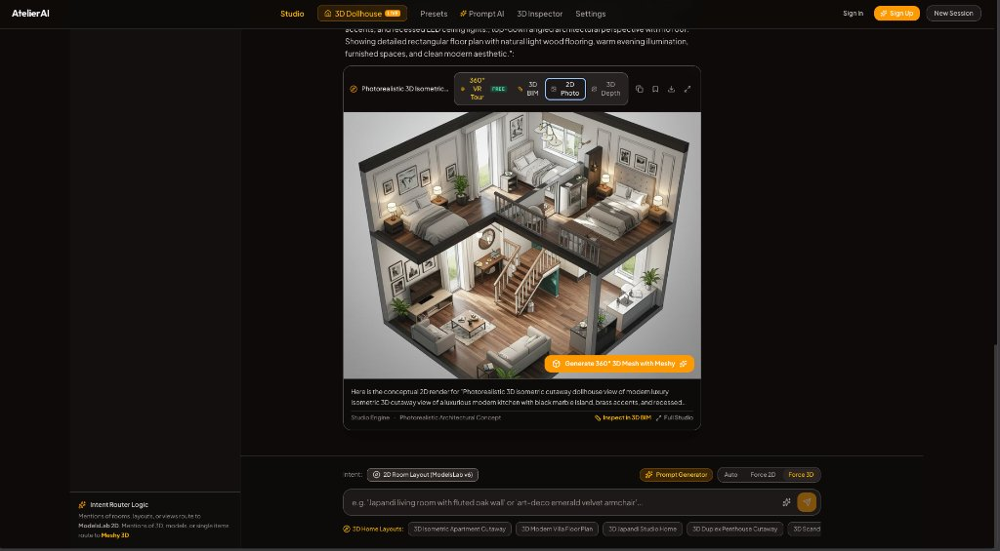

# 🏛️ AtelierAI — Intelligent Interior & 3D Spatial Design Studio

[](https://vitejs.dev/)
[](https://react.dev/)
[](https://threejs.org/)
[](https://tailwindcss.com/)
[](https://www.typescriptlang.org/)

**AtelierAI** is a real-time generative interior architecture studio that translates natural language prompts (English, Hindi, and Hinglish) into interactive architectural layouts, 360° VR interior tours, CAD-dimensional BIM dioramas, WebGL depth displacement meshes, and downloadable orbital 3D models (.GLB).

<div align="center">
  
</div>

---

## 🌟 Key Features

### 1. 🌐 360° VR Interior Spherical Tours
- **Equirectangular Camera Projection**: Synthesizes full $360^\circ$ interior rooms with realistic ceiling-to-floor immersion.
- **Interactive Orbit**: Pan and tilt freely in any direction with auto-orbit and field-of-view (FOV) zoom controls.
- **Free Studio Generation**: Built-in neural synthesis pipeline without recurring per-render credit walls.

### 2. 📐 Architectural 3D Spatial BIM Studio
- **Dimensional Space Planning**: Inspect exact room measurements ($L \times W \times H$) in meters and usable area ($\text{m}^2$ & $\text{sq.ft}$).
- **Interactive 2D Blueprint Mini-Map (1:100 Scale)**: Fly the camera into specific zones (Kitchen Island, Dining Gallery, Living Veranda, Master Suites).
- **MEP Utility Conduits**: Real-time visual overlays for:
  - ⚡ **Electrical wiring** & junction lighting nodes
  - 💧 **Plumbing** & drainage supply lines
  - 💨 **HVAC** & airflow ventilation ducting
- **Automated Guided Tour**: Automated cinematic walkthrough mode guiding clients through room zones sequentially.

### 3. 🖼️ 3D WebGL Depth Displacement Mesh
- Custom vertex shader with height elevation calculated from surface luminance.
- Alpha feathered edge-blending with dynamic wireframe polygon mesh inspection.
- Resilient reverse-proxy architecture preventing cross-origin canvas tainting (CORS).

### 4. 📦 360° 3D Mesh Inspection (.GLB)
- Built-in `<model-viewer>` for inspecting furniture and spatial assets.
- PBR textures, environment lighting control, neutral lighting toggle, and one-click `.GLB` export.

### 5. 🗣️ Multilingual Intent & Translation Engine
- Supports prompt inputs in **English**, **Hindi**, and **Hinglish** (e.g., *"ek luxury bedroom ka 3D design dikhao jisme wooden floor ho"*).
- Smart intent routing distinguishing single furniture objects (`GENERATE_3D`) from multi-room cutaway layouts (`GENERATE_2D`).

---

## 🏗️ Architecture & Tech Stack

- **Frontend**: React 19, TypeScript, Vite, Tailwind CSS, Lucide Icons, `@google/model-viewer`
- **3D & Graphics Engine**: Three.js (WebGL, custom ShaderMaterials, Equirectangular Spheres, PCF Soft Shadows)
- **Backend**: Express.js, TypeScript runtime via `tsx`, Reverse Proxy Image Pipe
- **AI Pipelines**:
  - Google Gemini AI (`@google/genai`) for architectural prompt enrichment
  - ModelsLab Interior API v6 & Atelier Neural Fallback Engine
  - Meshy AI Image-to-3D / Text-to-3D with local quad-topology simulation fallback
- **Database & Auth**: Cloud Firestore, Firebase Authentication

---

## 🚀 Getting Started

### Prerequisites
- [Node.js](https://nodejs.org/) (v18.0 or higher recommended)
- `npm` or `bun`

### Installation

1. **Clone the repository:**
   ```bash
   git clone https://github.com/Sankalp28Roop/atelierai-interior-3d-spatial-studio.git
   cd atelierai-interior-3d-spatial-studio
   ```

2. **Install dependencies:**
   ```bash
   npm install --legacy-peer-deps
   ```

3. **Configure Environment Variables:**
   Create a `.env` file in the root directory:
   ```env
   PORT=3000
   GEMINI_API_KEY=your_gemini_api_key_here
   MESHY_API_KEY=your_meshy_api_key_here          # Optional: For external 3D meshing
   MODELSLAB_API_KEY=your_modelslab_api_key_here  # Optional: For external 2D interior renders
   ```

4. **Start the Development Server:**
   ```bash
   npm run dev
   ```

5. **Open in Browser:**
   Navigate to [http://localhost:3000](http://localhost:3000).

---

## 🧪 Testing the 4 Viewing Modes

| Mode | Capability | How to Test |
| :--- | :--- | :--- |
| **360° VR Tour** | Immersive equirectangular interior | Click `360° VR Tour [FREE]` and drag to look around in 360°. |
| **3D BIM Tour** | Dimensional cutaway & CAD floor plan | Click `3D BIM Tour`, toggle utility conduits, and click mini-map rooms. |
| **2D Photo** | Photorealistic architectural concept | Click `2D Photo` to inspect textures or open the high-res Lightbox. |
| **3D Depth** | Extruded displacement perspective | Click `3D Depth` to orbit the 3D plane and toggle wireframe. |

---

## 📁 Project Structure

```text
├── public/
│   ├── assets/images/       # High-resolution architectural curated renders
│   └── models/              # Binary 3D models (.glb) for orbital inspection
├── src/
│   ├── components/
│   │   ├── ArchitecturalSpatialStudio.tsx # 3D BIM Studio with floor plan & utilities
│   │   ├── Panorama360Viewer.tsx          # Three.js 360° Equirectangular VR Sphere
│   │   ├── Depth3DCanvas.tsx              # WebGL Depth Displacement Mesh & Wireframe
│   │   ├── SceneImageViewer.tsx           # Multi-mode unified card viewer
│   │   ├── ModelViewerContainer.tsx       # <model-viewer> 3D GLB inspector
│   │   └── ImageWithFallback.tsx          # Resilient asset loader
│   ├── utils/
│   │   ├── intentRouter.ts                # Analyzes user prompt intent (2D vs 3D)
│   │   └── translator.ts                  # Hindi / Hinglish to architectural English
│   ├── contexts/AuthContext.tsx           # Firebase Authentication Provider
│   ├── services/firebase.ts               # Firestore design persistence
│   ├── App.tsx                            # Main Studio application shell
│   └── main.tsx                           # React entrypoint
├── server.ts                              # Express proxy, Gemini & 3D generation API
├── vite.config.ts                         # Vite configuration
└── package.json                           # Dependencies & scripts
```

---

## 📄 License
This project is open-source and available under the [MIT License](LICENSE).
